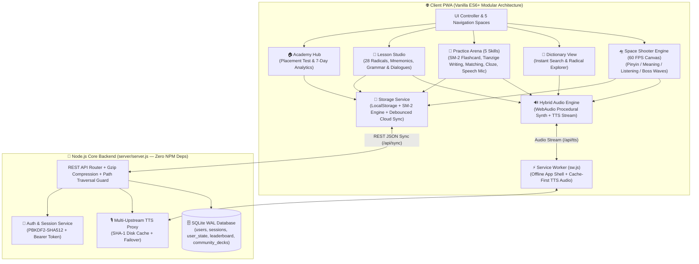

# 🛸 HSK Cosmic Academy — Full-Stack Gamified Mandarin Learning Platform (HSK 0–5)

[-339933?logo=node.js&logoColor=white)](https://nodejs.org/)
[-003B57?logo=sqlite&logoColor=white)](https://sqlite.org/)
[](#)
[](#)
[](https://opensource.org/licenses/MIT)

> **HSK Cosmic Academy** là nền tảng EdTech Full-Stack tích hợp **4 không gian học tiếng Trung toàn diện** từ con số 0 đến HSK 5: **(1) Bài giảng Chiết tự 28 Bộ thủ, Ngữ pháp & Hội thoại**, **(2) Phòng luyện 5 kỹ năng đa phương thức (Thẻ nhớ Anki SM-2, Tập viết chữ Hán ô chữ Điền chấm nét Pixel-Mask, Ghép cặp, Điền khuyết, Xếp câu & Chấm phát âm qua Mic)**, **(3) Game Bắn Từ Vựng Phản Xạ Vũ Trụ 60 FPS**, và **(4) Hệ thống Cloud Sync, Bảng xếp hạng & Chia sẻ học liệu cộng đồng**.

---

## 🌟 Điểm Nhấn Kỹ Thuật & Sản Phẩm (Key Engineering Highlights)

| Hạng Mục | Thông Số / Kiến Trúc Thực Tế |
| :--- | :--- |
| **Kho Học Liệu Chuẩn Hóa** | **6 bộ giáo trình (HSK 0 – HSK 5)**, **42 bài học (Units)**, **930 từ vựng chuẩn hóa** (Hán tự, Pinyin có dấu/không dấu, biến thể `ü ↔ v/u`, nghĩa tiếng Việt rút gọn & đầy đủ) + **42 Boss câu giao tiếp trọng tâm** |
| **Kiến Trúc Backend Zero-Dependency** | Xây dựng 100% trên **Node.js Core (`node:http`, `node:sqlite`, `node:crypto`, `node:zlib`)** — không phụ thuộc `node_modules` bên thứ ba, loại bỏ hoàn toàn rủi ro chuỗi cung ứng (Supply-Chain Vulnerabilities), khởi động tức thì `< 50ms` |
| **Cơ Sở Dữ Liệu & Bảo Mật** | **SQLite (`DatabaseSync` WAL mode)** xử lý truy vấn đồng thời; xác thực người dùng với **PBKDF2-SHA512 (100,000 vòng lặp)** + `crypto.timingSafeEqual` chống Timing Attack; chặn Path Traversal (`403 Forbidden`) |
| **Thuật Toán Ôn Tập Ngắt Quãng (SRS)** | Cài đặt chuẩn thuật toán **Anki SM-2** (`easeFactor`, `intervalHours`, `repetitions`, `nextReviewAt`, phân tách độ thông thạo theo từng kỹ năng: *Đọc, Viết, Nghe, Phát âm*) |
| **Chấm Viết Chữ Hán & Chấm Phát Âm** | Vẽ chữ Hán trên lưới **Ô Chữ Điền (田字格)** kèm thuật toán **Pixel-Mask IoU Overlap Grader** chấm điểm nét viết trực tiếp trên HTML5 Canvas; tích hợp **Web Speech Recognition (`zh-CN`)** chấm điểm phát âm bằng giọng nói |
| **Hybrid Audio & TTS Proxy Cache** | Kết hợp **Web Audio API** (tổng hợp nhạc nền Ambient Sci-Fi & hiệu ứng Laser/Explosion procedural 0MB asset) với **Multi-Upstream TTS Proxy** (Youdao / Google TTS + SHA-1 Disk Cache + Service Worker Cache-First) |
| **Kiểm Thử Tự Động (E2E & Turbo QA)** | Bộ kiểm thử E2E Full-Stack (`scripts/test_platform_e2e.js`) và **Turbo Game QA Suite (`window.GameQA`)** giả lập AI Auto-PlayBot & Time-Warp kiểm định toàn bộ 42 màn chơi trong `< 20ms` |

---

## 🏛️ Kiến Trúc Hệ Thống (System Architecture)



---

## 🎯 Chu Trình Học Tập Khoa Học 4 Bước (4-Stage Pedagogical Loop)

1. **🏠 Học Viện & Kiểm Tra Trình Độ Đầu Vào (`js/learning/academyHub.js`)**
   - Bài test đầu vào 8 câu giúp phân loại chính xác trình độ từ **Nhập môn (Cấp 0)** đến **HSK 4–5**.
   - Bảng điều khiển theo dõi mục tiêu từ vựng hàng ngày, chuỗi ngày học liên tiếp (**Streak**), cấp độ Phi công (**XP/Level**), và biểu đồ cột thống kê 7 ngày gần nhất.
2. **📖 Bài Giảng Chiết Tự, Ngữ Pháp & Hội Thoại (`js/learning/lessonStudio.js`)**
   - **Chiết tự chữ Hán & 28 Bộ thủ cốt lõi**: Tách bộ thủ, giải nghĩa tượng hình/hội ý/hình thanh và mẹo nhớ nhanh (Mnemonics) cho từng từ.
   - **Ngữ pháp trọng tâm & Hội thoại thực tế**: Công thức câu, ví dụ song ngữ Trung – Pinyin – Việt và đoạn hội thoại giao tiếp phát âm từng câu.
3. **🎯 Phòng Luyện Tập Đa Kỹ Năng 5-Trong-1 (`js/learning/practiceArena.js`)**
   - **🃏 Thẻ nhớ thông minh SM-2**: Tự đánh giá 4 mức (*Quên, Khó, Nhớ được, Quá dễ*) để thuật toán tính toán chính xác thời điểm ôn lại.
   - **✍️ Tập viết chữ Hán trên Ô Chữ Điền (田字格)**: Hỗ trợ nét mờ dẫn hướng (Ghost Stroke Guide) và chấm điểm độ khớp nét viết bằng ma trận điểm ảnh.
   - **🧩 Ghép cặp siêu tốc (Speed Matching)**: Nối nhanh Hán tự với Pinyin và Nghĩa tiếng Việt.
   - **📝 Trắc nghiệm điền khuyết ngữ cảnh (Contextual Cloze Quiz)**: Chọn từ đúng điền vào câu giao tiếp thực tế.
   - **🔀 Xếp câu & Chấm phát âm qua Mic (Sentence Builder & Speech Check)**: Sắp xếp các cụm từ thành câu hoàn chỉnh và đọc vào Microphone để chấm độ chuẩn xác.
4. **🛸 Game Bắn Từ Vựng Phản Xạ Vũ Trụ (`js/engine/gameEngine.js`)**
   - **4 chế độ chiến đấu**: Bắn Pinyin (`🔤`), Bắn Nghĩa tiếng Việt (`🇻🇳`), Luyện Nghe bắn từ (`🎧`), và Kết hợp xen kẽ (`🔄`).
   - **Hỗ trợ gõ linh hoạt**: Chấp nhận cả Pinyin không dấu/số thanh điệu (`1–4`), tự động quy đổi `ü ↔ v/u` (ví dụ: `lvyou` hoặc `luyou` cho `旅游`), và gõ tiếng Việt không dấu.
   - **Đấu Boss Bài Khóa cuối màn**: Tổng hợp từ vựng trong bài thành câu giao tiếp dài kèm lá chắn đa tầng.

---

## 📂 Cấu Trúc Thư Mục (Project Structure)

```text
hsk-cosmic-academy/
├── index.html                  # Giao diện Single-Page Application (SPA) tích hợp 5 phân khu & SEO JSON-LD
├── manifest.webmanifest        # Cấu hình Progressive Web App (PWA) cài đặt trên Desktop/Mobile
├── sw.js                       # Service Worker quản lý Offline-First & Cache âm thanh TTS
├── package.json                # Scripts vận hành, kiểm thử E2E & Audit dữ liệu (0 external dependencies)
├── Dockerfile                  # Đóng gói Container siêu nhẹ trên nền node:22-alpine
├── css/
│   ├── style.css               # Hệ thống giao diện Sci-Fi HUD, Canvas & Responsive Touch Keyboard
│   └── academy.css             # Giao diện Học viện, Bài giảng, Ô chữ Điền & Phòng luyện tập
├── data/
│   └── curriculum_decks.json   # Dữ liệu xuất chuẩn hóa (6 Decks, 42 Units, 930 Words)
├── js/
│   ├── data/
│   │   ├── vocabDatabase.js    # Cơ sở dữ liệu 930 từ vựng HSK 0-5 & bộ chuẩn hóa Pinyin/Tiếng Việt
│   │   └── curriculumMeta.js   # Kho tri thức 28 Bộ thủ, Chiết tự, Ngữ pháp, Hội thoại & Placement Test
│   ├── services/
│   │   ├── storageService.js   # Quản lý trạng thái, thuật toán Anki SM-2, JSON Backup & Cloud Sync
│   │   └── apiClient.js        # HTTP Client giao tiếp REST API & đồng bộ tự động
│   ├── audio/
│   │   └── soundEngine.js      # Bộ tổng hợp âm thanh WebAudio API & phát giọng đọc TTS đa tầng
│   ├── engine/
│   │   ├── entities.js         # Thực thể thiên thạch chữ Hán, đạn Laser, hạt nổ Particle & Floating Text
│   │   └── gameEngine.js       # Vòng lặp 60 FPS, khóa mục tiêu thông minh & điều phối màn chơi
│   ├── learning/
│   │   ├── academyHub.js       # Trang chủ lộ trình, thống kê 7 ngày & bài test đầu vào
│   │   ├── lessonStudio.js     # Không gian bài giảng chiết tự, ngữ pháp & hội thoại
│   │   ├── practiceArena.js    # Phòng luyện 5 kỹ năng (SM-2, Tập viết ô Điền, Ghép từ, Quiz, Xếp câu)
│   │   ├── dictionaryView.js   # Từ điển tra cứu tức thì Hán/Pinyin/Việt & bảng 28 Bộ thủ
│   │   └── communityModal.js   # Tài khoản Cloud, Bảng xếp hạng XP & Chia sẻ bộ từ cộng đồng
│   ├── ui/
│   │   └── uiController.js     # Điều phối chuyển đổi 5 không gian học tập, Modal & sự kiện phím/chạm
│   └── qa/
│       └── gameQaSuite.js      # Công cụ tự động hóa kiểm thử AI Auto-PlayBot & Time-Warp (<20ms)
├── server/
│   ├── server.js               # HTTP Server, REST API, Gzip, Security Guards & TTS Proxy Cache
│   └── db.js                   # Lớp truy xuất SQLite WAL, PBKDF2 Auth, Sync, Leaderboard & Community Decks
└── scripts/
    ├── export_vocab_json.js    # Script trích xuất & kiểm định toàn bộ dữ liệu từ vựng sang JSON
    └── test_platform_e2e.js    # Bộ kiểm thử tích hợp tự động toàn diện (Syntax, SM-2, Server, SQLite, Security)
```

---

## 🚀 Hướng Dẫn Cài Đặt & Chạy Dự Án (Quick Start)

### Yêu cầu hệ thống
- **Node.js `>= 22.5.0`** (Sử dụng mô-đun `node:sqlite` tích hợp sẵn, không cần cài đặt gói phụ thuộc ngoài).

### 1. Khởi chạy Server Full-Stack
```bash
# Clone dự án
git clone https://github.com/Kizakawa/hsk-cosmic-academy.git
cd hsk-cosmic-academy

# Khởi động Backend Server + Giao diện Web tại cổng 8088
npm start
```
Mở trình duyệt truy cập: **`http://localhost:8088`** (hoặc chạy trực tiếp file `start_game.bat` trên Windows).

### 2. Chạy Kiểm Thử Tự Động (E2E & Data Integrity Audit)
```bash
# Chạy bộ kiểm thử Full-Stack E2E (Kiểm tra cú pháp 17 module, thuật toán SM-2, Auth, SQLite, API & Bảo mật)
npm test

# Kiểm định tính toàn vẹn của 930 từ vựng, biến thể Pinyin & ràng buộc DOM
npm run audit
```

### 3. Chạy bằng Docker
```bash
docker build -t hsk-cosmic-academy .
docker run -d -p 8088:8088 --name hsk-academy hsk-cosmic-academy
```

---

## 🔌 Danh Sách REST API Endpoints

| Phương thức | Endpoint | Mô tả chức năng |
| :---: | :--- | :--- |
| `GET` | `/api/health` | Kiểm tra trạng thái hoạt động, số lượng bộ từ, bài học và người dùng |
| `GET` | `/api/curriculum` | Lấy toàn bộ cấu trúc 6 bộ giáo trình, 42 bài học và 930 từ vựng |
| `GET` | `/api/vocab/search?q=...` | Tìm kiếm từ vựng tốc độ cao theo chữ Hán, Pinyin (có/không dấu) hoặc nghĩa tiếng Việt |
| `GET` | `/api/tts?text=...` | Proxy phát âm tiếng Trung chuẩn kèm bộ nhớ đệm SHA-1 trên ổ cứng (`X-TTS-Cache: HIT/MISS`) |
| `POST` | `/api/auth/register` | Đăng ký tài khoản học viên mới & khởi tạo hồ sơ năng lực trên đám mây |
| `POST` | `/api/auth/login` | Đăng nhập và nhận phiên Bearer Token cùng toàn bộ tiến độ học tập |
| `GET / POST` | `/api/sync` | Đồng bộ hai chiều tiến độ học tập, điểm XP, dữ liệu thẻ nhớ SM-2 và bộ từ cá nhân |
| `GET` | `/api/leaderboard` | Bảng xếp hạng Top học viên theo XP, cấp độ Phi công, chuỗi Streak và số từ thuộc lòng |
| `GET / POST` | `/api/community-decks` | Khám phá hoặc đóng góp các bộ từ vựng chuyên ngành cho cộng đồng |

---

## 📄 Giấy Phép (License)

Dự án được phân phối dưới giấy phép **MIT License**. Xem chi tiết hoặc tham khảo cách trình bày dự án này trong CV tại [CV_PORTFOLIO_GUIDE.md](CV_PORTFOLIO_GUIDE.md).
